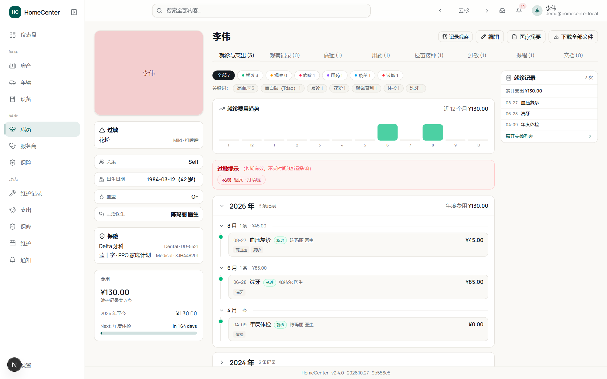
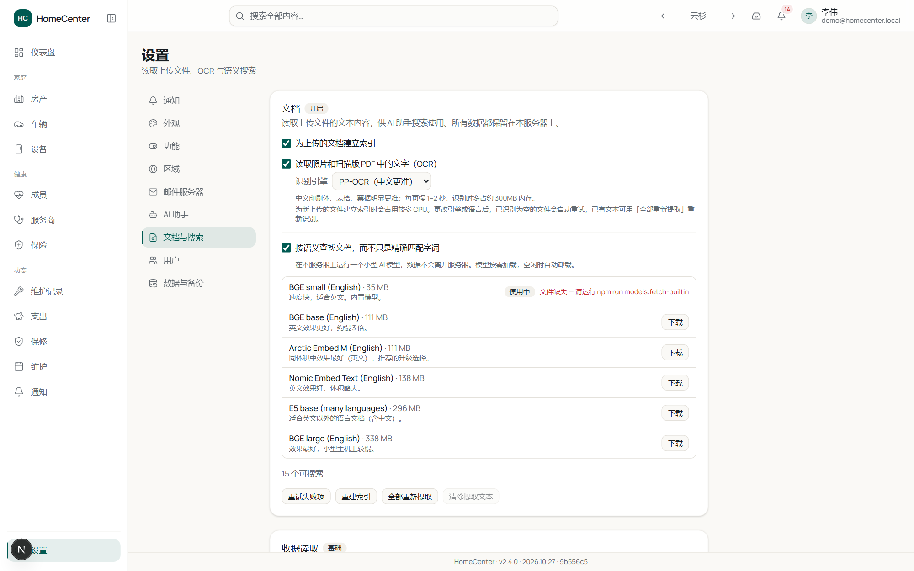

[英文文档](https://github.com/yatzin/home-center#readme) | 简体中文

<div align="center">

# HomeCenter 中文版

**家里的维修记录、保修、收据，家人的健康档案，放在自己的服务器上管理。**

  
[](https://github.com/yetandred/home-center-cn/actions/workflows/docker-zh-cn.yml)

</div>

这是 [yatzin/home-center](https://github.com/yatzin/home-center) 的中文分支，在原版（一个开源自托管的家庭资产管理应用）基础上做了这些事：

- **界面全部中文化**，包括页面、组件、通知邮件和演示数据，术语统一见 [ZH-CN-GUIDE.md](ZH-CN-GUIDE.md)
- **本地化默认值**：人民币、公里、平方米、24 小时制（设置里可改回其他格式）
- **中文 OCR**：内置离线简体中文语言包，另提供 PP-OCR 识别引擎，中文报告、票据的识别准确率比原版默认引擎高不少
- **AI 助手兼容性修补**：Base URL 自动补 `/v1`、Azure 支持、自定义请求头、推理模型兼容等，见 [CHANGELOG.md](CHANGELOG.md)
- **NAS 部署配置**：群晖 / 威联通 / 绿联 / 极空间的现成 compose 和步骤说明在 [deploy/nas/](deploy/nas/NAS部署指南.md)

功能与上游保持一致，上游发新版后会手动同步过来。

镜像地址 `ghcr.io/yetandred/home-center-cn:zh-cn`（amd64 + arm64）。许可为 PolyForm Noncommercial 1.0.0（仅限非商业使用），与上游一致。

## 它长什么样

| | |
|---|---|
|  仪表盘：提醒、即将到期的保修、支出趋势 |  房产详情：维护记录、保修、文档都挂在资产上 |
|  成员健康档案：就诊与支出按年月排列，可折叠，可打印摘要 |  全局搜索：记录、附件、文档正文一起查 |

## 主要功能

- **房产、车辆、设备**：每样资产一个页面，维护记录、保修、收据、说明书都挂在上面，可整包下载。
- **提醒**：按日期或里程设周期，到期前通知；完成提醒时自动写入维护历史，反过来记一笔维护也能顺手关掉对应提醒。
- **健康档案**（可关）：成员、就诊、用药、疫苗、过敏，时间线浏览，就诊时能打印一份摘要带走。
- **支出统计**：按月汇总全家的维护开销，可按资产、分类、商家筛选。
- **文档搜索**：PDF、Word、Excel、PPT、图片（OCR）的全文索引，支持语义搜索，索引和识别全部在本机完成。
- **AI 助手**（可选）：接 OpenAI 兼容接口，包括 Ollama、LM Studio 这类本地模型；不配置就完全不启用。
- **备份**：应用内备份与恢复，可选恢复密钥或密码保护，支持定时任务。

## 快速开始

需要一台能跑 Docker 的机器（NAS 也行），大约五分钟。

**1. 建数据目录**

```bash
mkdir -p /volume1/docker/homecenter
```

**2. 保存为 `docker-compose.yml`**

```yaml
services:
  homecenter:
    image: ghcr.io/yetandred/home-center-cn:zh-cn
    ports:
      - "3000:3000"
    volumes:
      - /volume1/docker/homecenter:/data
    environment:
      DATABASE_URL: "file:/data/homecenter.db"
      AUTH_SECRET: ""
      AUTH_URL: ""
      MAX_UPLOAD_BYTES: "26214400"
      ADMIN_NAME: "Admin"
      ADMIN_EMAIL: "your@email.com"
      ADMIN_PASSWORD: "changeme"
    restart: unless-stopped
    healthcheck:
      test: ["CMD", "wget", "-qO-", "http://127.0.0.1:3000/api/health"]
      interval: 30s
      timeout: 10s
      retries: 3
      start_period: 10s
```

**3. 填三个值**

| 变量 | 说明 |
|---|---|
| `AUTH_SECRET` | 必填。随机密钥：`openssl rand -base64 32`。不设置无法登录。 |
| `ADMIN_EMAIL` / `ADMIN_PASSWORD` | 首次启动时创建管理员账户用，之后可忽略。 |
| `AUTH_URL` | 你访问用的地址，如 `http://192.168.1.50:3000`。留空自动检测。 |

**4. 启动并登录**

```bash
docker compose up -d
```

打开 `http://<服务器IP>:3000/login` 登录。上传的文件和下载的模型都存在 `/data` 里，更新容器不影响。

群晖、威联通等 NAS 的图形界面部署步骤见 [deploy/nas/NAS部署指南.md](deploy/nas/NAS部署指南.md)。

## 文档识别（OCR）

照片和扫描版 PDF 的文字识别有两个引擎可选（**设置 → 文档与搜索**），切换后识别为空的文件会自动重试，已有文本可点「全部重新提取」重识别：

| | Tesseract（默认） | PP-OCR |
|---|---|---|
| 中文准确率 | 一般，表格和票据容易认错字 | 明显更好，报告、票据基本逐字正确 |
| 速度 | 快 | 每页慢 1–2 秒 |
| 内存 | 小 | 识别时约多占 300 MB，空闲后自动释放 |
| 中文语言包 | 内置离线（`chi_sim`） | 内置离线，中英混排无需选语言 |

两个引擎的模型都随镜像分发，运行时不联网下载。



## 更新

```bash
docker compose pull && docker compose up -d
```

数据目录不受影响。每次构建改了什么，看 [CHANGELOG.md](CHANGELOG.md)；应用页脚会显示当前构建标识（如 `2026.10.27 · cc8b0bb`），点它就能对上日志里的条目。

镜像提供三种标签：`zh-cn`（跟随最新）、`zh-cn-20261027`（按日期快照）、`zh-cn-cc8b0bb`（按提交锁定）。想固定在某个版本，把 compose 里的标签换成后两种之一即可。

## 常见问题

**需要联网吗？**

不需要。OCR、语义搜索、AI 助手（指向本地模型时）都在内网完成。只有邮件提醒、云端 AI 服务商、下载更大的搜索模型这几种情况会出网。

**怎么备份？**

设置 → 数据。支持定时备份、恢复密钥或密码保护，恢复可以在应用内做，也可以在容器起不来时用命令行做（`npm run restore`）。细节见应用内说明。

**健康数据安全吗？**

存在你自己服务器的数据库里，受登录保护，登录失败有限速。AI 助手默认读不到健康文档，整个健康板块也可以在设置里关掉。数据库文件本身未加密，请像对待其他隐私文件一样看管好数据目录。

**原版和这个分支怎么选？**

需要中文界面或主要录入中文单据，用这个分支；纯英文环境用原版即可。两者数据结构一致，但分支加了中文字段默认值，建议不要混用两边的镜像跑同一个数据目录。

## 本地开发

```bash
npm install
cp .env.example .env   # 填写 AUTH_SECRET
npm run db:seed
npm run dev
```

运行在 [http://localhost:3000](http://localhost:3000)，数据库在 `prisma/dev.db`。其他命令：

```bash
npm run db:migrate   # 创建/应用迁移
npm run db:studio    # 浏览数据库
npm run build        # 生产构建
npm run models:fetch-builtin   # 下载内置语义搜索模型（开发环境需要一次）
```

## 许可证

HomeCenter 采用 [PolyForm Noncommercial License 1.0.0](https://polyformproject.org/licenses/noncommercial/1.0.0/) 许可，可自由用于非商业目的，商业使用需联系版权持有者。该许可限制商业使用，因此不属于 OSI 定义的开源软件。

<sub>截图中的演示数据为应用内置种子数据；部分照片来自 Wikimedia Commons，遵循各自声明。</sub>
