[English](README.md) | 简体中文

<div align="center">

# HomeCenter

**把家中、车辆和家人的每一次维修、保修和收据，都管理在自己的服务器上。**

为你的房产、车辆、设备和家人健康提供维护历史、费用与提醒。每张收据和说明书都可搜索，全部运行在一个 Docker 容器里。

**[详情见 home-center.dazzos.com](https://home-center.dazzos.com/)**

**[5 分钟安装](#get-started)** · [功能](#features) · [AI 助手](#ask-your-house-a-question) · [演示](#see-it-in-action) · [常见问题](#faq) · [更新](#updating)

   
[](https://github.com/yatzin/home-center/actions/workflows/docker-publish.yml) [](https://github.com/yatzin/home-center/commits/main)

</div>

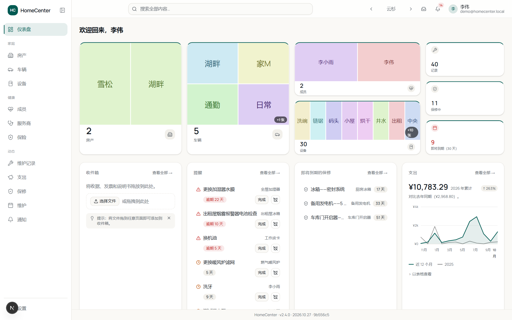

<p align="center">
✓ 运行在你的 NAS 或服务器上 &nbsp;·&nbsp; ✓ 无第三方登录 &nbsp;·&nbsp; ✓ OCR 与搜索在本机运行 &nbsp;·&nbsp; ✓ 支持本地 AI 模型
</p>

## 演示

以下是在演示数据上录制的简短操作演示，点击即可播放。

<table>
<tr>
<td width="33%" valign="top"><a href="docs/screenshots/demos/tour.gif"></a><br><b>快速浏览</b> <sub>1:03</sub><br><sub>一座房子、一辆卡车和一个人，逐个标签页看过去</sub></td>
<td width="33%" valign="top"><a href="docs/screenshots/demos/ask-ai-warranty.gif">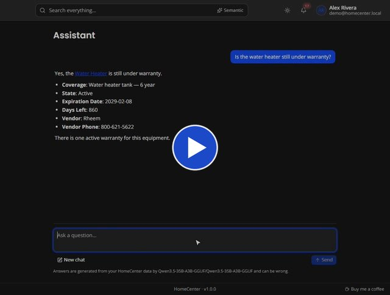</a><br><b>向助手提问</b> <sub>0:38</sub><br><sub>从一个问题，到能回答它的保修 PDF</sub></td>
<td width="33%" valign="top"><a href="docs/screenshots/demos/reminder-to-done.gif">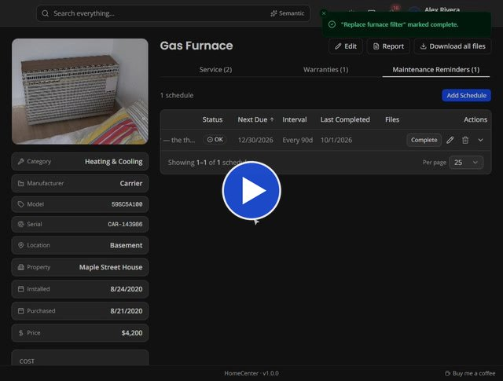</a><br><b>提醒到完成</b> <sub>0:32</sub><br><sub>一条已逾期的更换滤芯提醒，完成并设定下次日期</sub></td>
</tr>
<tr>
<td width="33%" valign="top"><a href="docs/screenshots/demos/costs-to-receipt.gif"></a><br><b>从费用到收据</b> <sub>0:33</sub><br><sub>从支出图表一路查到那张 2,340 美元的发票</sub></td>
<td width="33%" valign="top"><a href="docs/screenshots/demos/search-documents.gif"></a><br><b>搜索你的单据</b> <sub>0:27</sub><br><sub>搜索 “roof” 就能找到那份 30 年屋瓦保修</sub></td>
<td width="33%" valign="top"><a href="docs/screenshots/demos/health-summary.gif">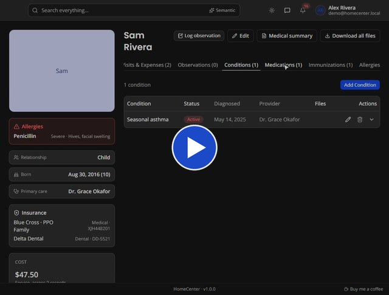</a><br><b>健康摘要</b> <sub>0:32</sub><br><sub>用药、疫苗接种，以及一份可打印的摘要</sub></td>
</tr>
</table>

## 2.0 版新功能

以下是上述演示和截图录制之后新增的功能。

- **收件箱（Intake）：** 把收据、照片、PDF 或转发的邮件（`.eml`、`.msg`）拖放到应用内任意位置。HomeCenter 会读取日期、商家和金额，建议它们归属哪个资产，并让你把它们归档为新的维护记录或附加到现有记录。归档收据时还会提示补全对应的提醒；文件超过一周未归档时会出现提醒。
- **本地 AI 读取收据** *（可选）*：在**设置 → 收据读取**中，可使用内置解析器或本地模型处理较复杂的收据。如果模型读不了某个文件，收件箱会明确告知，而不是悄悄回退。
- **更多提醒控制：** **跳过本次**可将提醒顺延到下一个周期而不记录维护；**添加默认提醒**可为空的维护标签页填入一套起始计划。
- **主题：** 十二套主题，明暗皆有，可从顶栏选择，或用其箭头逐个切换。
- **布局随心：** 侧边栏可折叠为图标，并可按设备选择 AI 助手按钮和收件箱的位置（**设置 → 外观**）。
- **更精准的搜索：** 精确匹配优先，其次按语义排序，最后是部分匹配。

## 功能

上次保养暖气炉是什么时候？冰箱还在保修期内吗？去年那辆卡车花了多少钱？HomeCenter 把这些答案集中在一处，并在事项到期前提醒你。

| | |
|---|---|
| **房产** | 房产、车辆和设备，附带维护记录、保修和提醒 |
| **健康** *（可选）* | 成员、医疗机构和保险，附带就诊、用药和疫苗接种 |
| **费用** | 按资产、分类和商家统计费用，附 12 个月支出图表 |
| **查找** | 跨记录和文档的全局搜索，外加可选的 AI 助手 |
| **提醒** | 应用内铃铛通知，以及按成员的邮件摘要 |
| **记录与导出** | 附件、可打印报告、完整的离线导出，以及带恢复功能的定时备份（[备份说明](#how-do-i-back-it-up)） |
| **安全** | 本地登录、管理员与普通用户、登录限流、加密存储的机密信息 |

### 每栋房子、每辆车、每台电器，连同它的全部历史

为你拥有的每件东西建一个页面：照片、详细信息，以及挂在上面的每一次维修、保修和提醒。

- **房产：** 独栋住宅、公寓、度假小屋和土地。
- **车辆：** 按里程记录的维护历史。
- **设备：** 关联到所在房产，记录型号和序列号。
- **房间** *（可选）*：房产内的各个房间，含油漆颜色和地板材质，以及每个房间内的设备、维护和提醒。可在**设置 → 功能**中关闭。
- **文档：** 归属于资产本身的文件，如地契、车辆产权证或说明书，无需关联维护记录。
- 为任意资产**打包下载全部文件**为 zip。

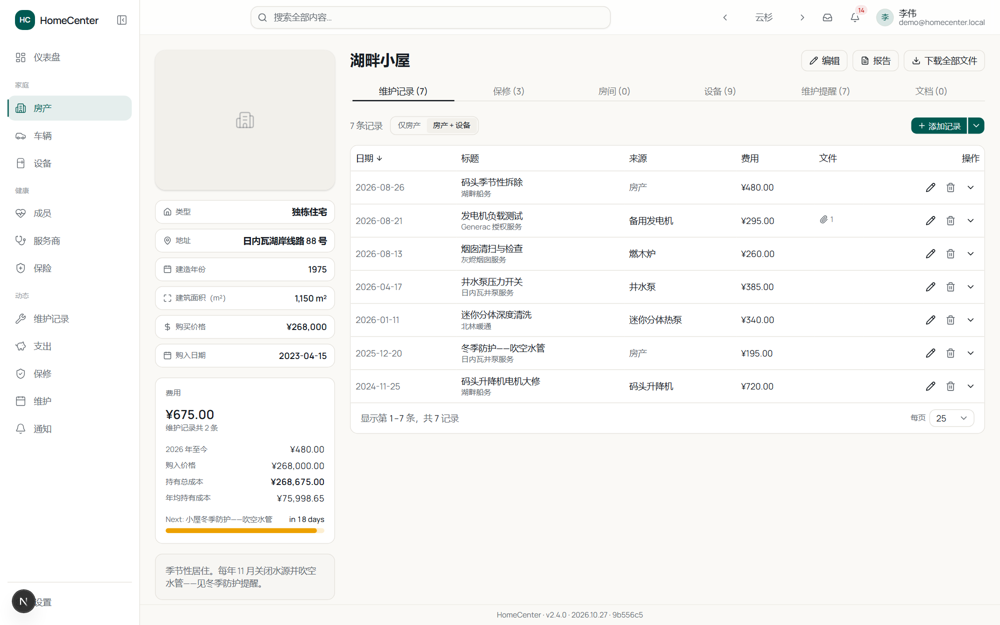

<p>
<a href="docs/screenshots/2.Properties.png"></a>
<a href="docs/screenshots/7.Vehicles.png">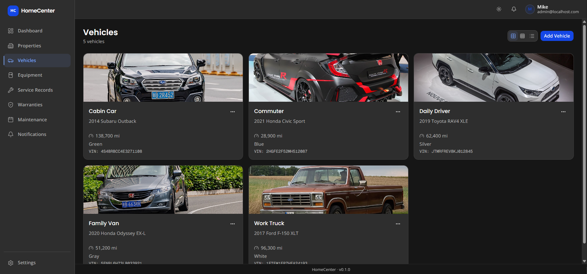</a>
<a href="docs/screenshots/8.VehicleService.png">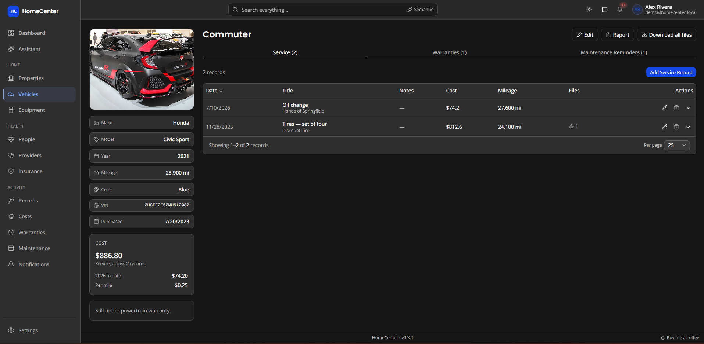</a>
<a href="docs/screenshots/9.Equipment.png">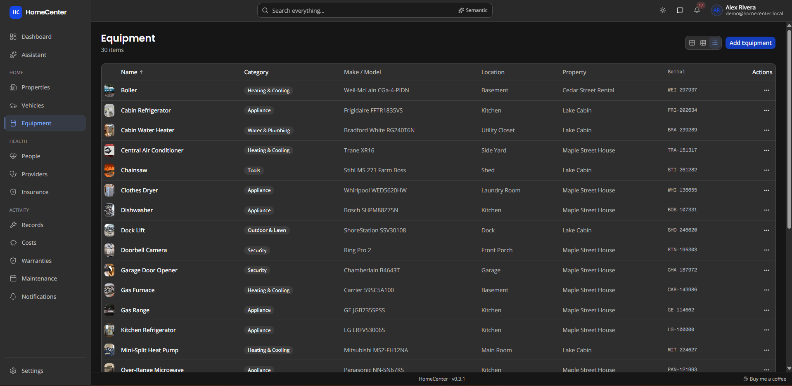</a>
</p>

### 在逾期之前就心中有数

只需按天数或里程设置一次提醒。HomeCenter 会算出下次到期日，并及时通知你。

- **按日期或里程**设置周期，提前预警时间由你决定。
- **保修状态**一目了然：生效中、即将到期或已过期。
- 跨所有资产的**总览**，可排序、可筛选。
- **闭环管理：** 完成提醒时会自动记入维护历史，包含费用、商家和收据；反过来，记录一次维护也可同时把对应提醒标记为完成。
- 可在仪表盘或资产页**稍后提醒或暂停**提醒。稍后提醒的会在到期后重新出现；暂停的会保持安静，直到你恢复。

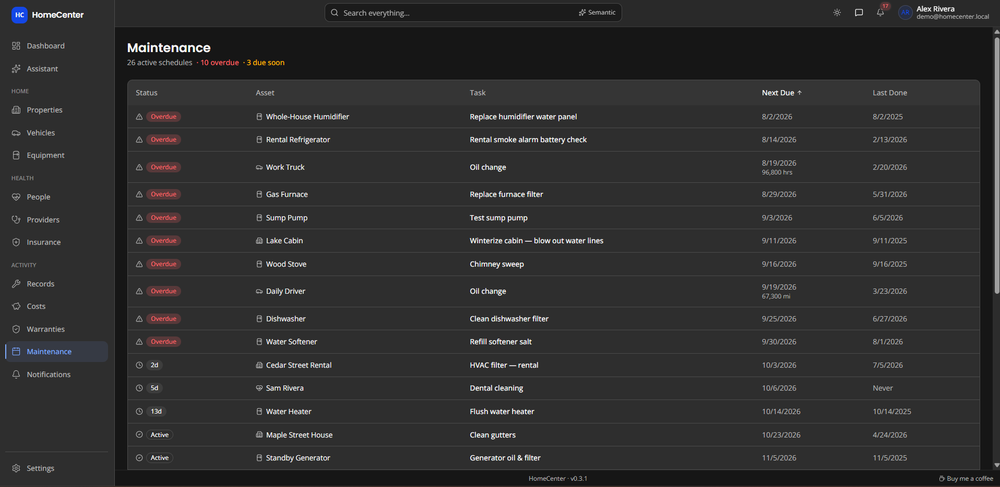

<p>
<a href="docs/screenshots/6.MaintenanceReminders.png"></a>
<a href="docs/screenshots/5.Warranties.png">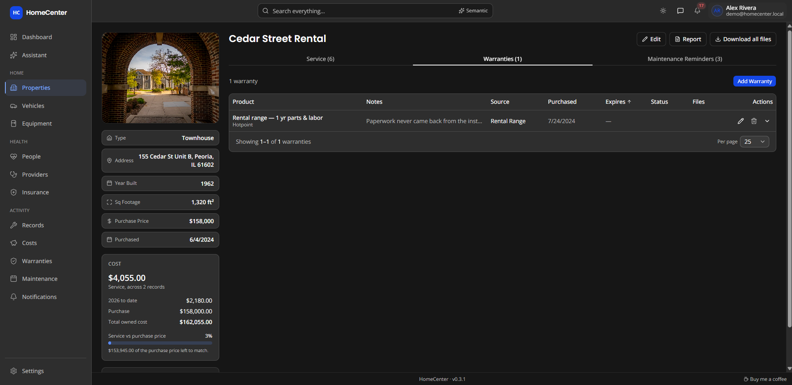</a>
<a href="docs/screenshots/10.WarrantyOverview.png">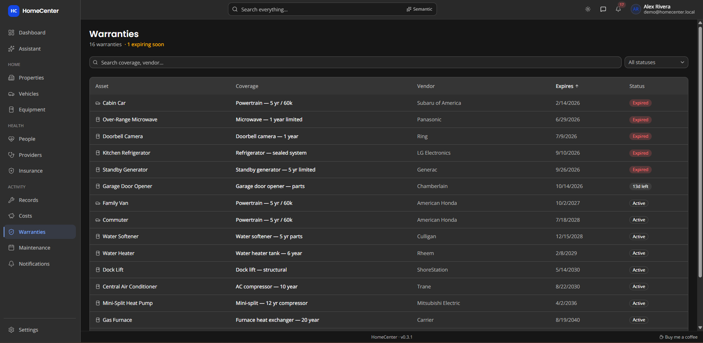</a>
<a href="docs/screenshots/4.ServiceRecord.png">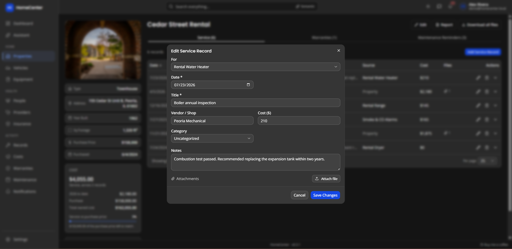</a>
</p>

### 家人的健康档案，触手可及 *（可选）*

把每位成员的健康情况集中管理，就诊时打印一份清爽的摘要带走。

- **病症、用药、过敏**和疫苗接种。
- **就诊**关联医疗机构，并记录费用。
- **观察记录**，便于发现症状规律。
- **续药、疫苗和保险**提醒。
- 不需要的话，可在**设置 → 功能**中关闭整个板块。


<p>
<a href="docs/screenshots/14.Providers.png"></a>
<a href="docs/screenshots/15.Insurance.png"></a>
<a href="docs/screenshots/16.MedicalSummary.png"></a>
</p>

### 看清钱花在了哪里

每条维护记录都带有费用，HomeCenter 会汇总整个家庭的支出。

- **按月、按季度或按年**的趋势，附带移动平均线。
- 支出最多的资产、分类和商家。
- **最大支出**与年初至今累计。
- 可按房产、车辆、设备或成员筛选。

<p>
<a href="docs/screenshots/17.Costs1.png">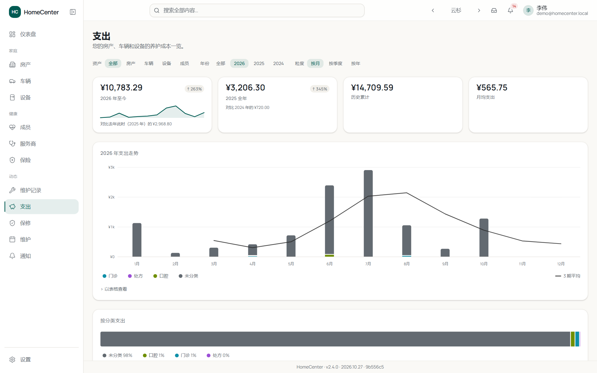</a>
<a href="docs/screenshots/17.Costs2.png">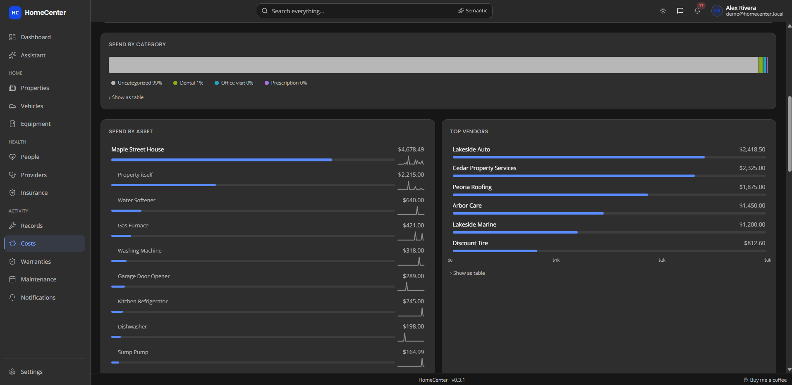</a>
</p>

### 什么都能搜到，连说明书里都行

一个搜索框覆盖所有资产、记录，以及你上传过的每个文件的正文。用你自己的话提问，它能找到你想表达的意思。

- 可**读取** PDF、Word、Excel、PowerPoint、OpenDocument、RTF 和文本文件。
- 照片和扫描版 PDF 支持 **OCR**。
- **按语义搜索**，使用一个运行在你服务器上的小型模型。
- 索引和 OCR 在后台运行，全部在你的服务器上完成。

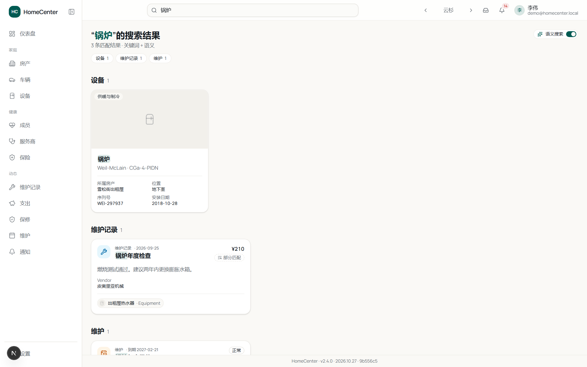

### 向你的房子提问

AI 助手 *（可选）* 会查阅你的记录和文档，用平实的语言回答问题，并附上指向来源的链接。

- 支持 OpenAI、OpenRouter、Ollama、LM Studio 或任何 OpenAI 兼容服务器。
- **完全本地运行**，任何数据都不会离开你的网络。
- 由你决定它能否读取文档和健康数据。
- 对话只保存在你的浏览器里，永远不会存储在服务器上。

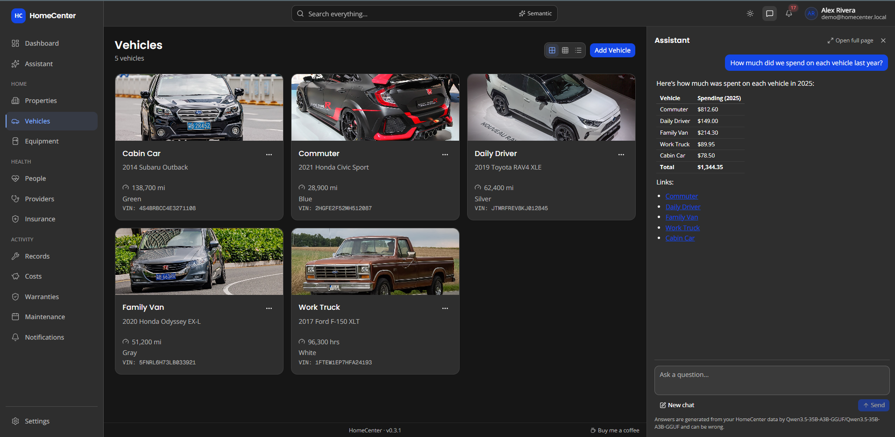

### 提醒与报告

提醒在应用内送达，也可以按你的需要通过邮件送达。报告则把一份资产的历史整理成文档，可以交给买家、修理厂或医生。

- 按成员的**邮件摘要**：尽快、每天或每周。
- **在设置中配置邮件服务器**，附测试按钮。
- 通知可**忽略与恢复**。
- **可打印的资产报告**和医疗摘要。

<p>
<a href="docs/screenshots/18.Notifications.png"></a>
<a href="docs/screenshots/12.EmailNotifications.png">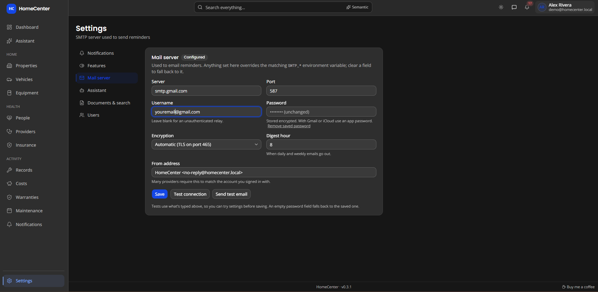</a>
<a href="docs/screenshots/19.AssetReport.png">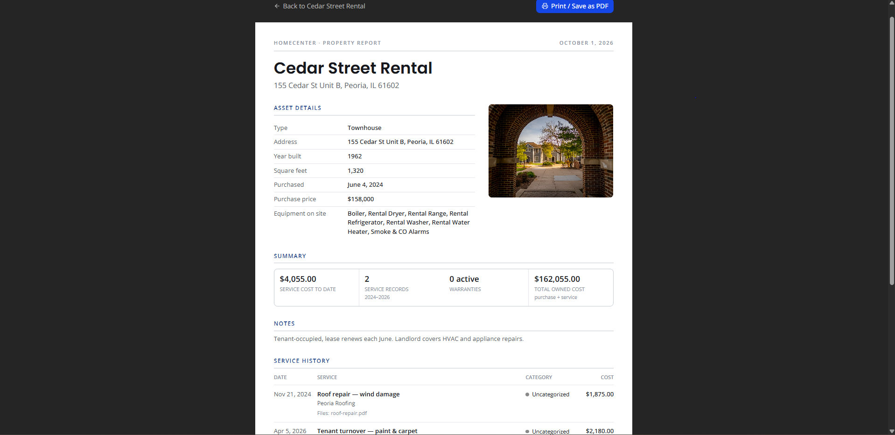</a>
</p>

## 隐私优先的设计

HomeCenter 是一个容器加一个数据目录，两者都归你所有。

- **自托管：** 可运行在 Synology、Unraid 或任何 Docker 主机上。更新永远不会触碰你的数据目录。
- **本机处理：** OCR 和语义搜索都在容器内运行，唯一的网络请求是可选的模型下载。
- **由你决定：** AI 助手默认关闭，开启才生效；健康板块可以完全隐藏。登录为本地验证，用户分为管理员和普通用户，连续登录失败会被限速，邮件密码和 API 密钥均以加密形式存储。

<sub>截图中的照片来自 <a href="https://commons.wikimedia.org/">Wikimedia Commons</a>，由多位作者提供，遵循各自声明（多为 CC BY-SA）。</sub>

## 开始使用

部署大约需要五分钟。你需要：

| 前提条件 | 原因 |
|---|---|
| Docker + Docker Compose | 应用的运行方式。无需 Node.js 或构建环境。 |
| 宿主机上用于数据的目录 | 存放数据库和上传文件，且在更新后依然保留 |
| 约 5 分钟 | 设置一个必填项并启动容器 |

### 安装（Docker）

这是运行 HomeCenter 的推荐方式。

**1. 为数据创建一个目录**，例如在 Synology NAS 上：

```bash
mkdir -p /volume1/docker/homecenter
```

**2. 把以下内容保存为 `docker-compose.yml`**（或粘贴到 Portainer → Stacks → Add stack）：

```yaml
services:
  homecenter:
    image: ghcr.io/yatzin/homecenter:latest
    ports:
      - "3000:3000"
    volumes:
      - /volume1/docker/homecenter:/data
    environment:
      DATABASE_URL: "file:/data/homecenter.db"
      AUTH_SECRET: ""
      AUTH_URL: ""
      MAX_UPLOAD_BYTES: "26214400"
      ADMIN_NAME: "Admin"
      ADMIN_EMAIL: "your@email.com"
      ADMIN_PASSWORD: "changeme"
    restart: unless-stopped
    healthcheck:
      test: ["CMD", "wget", "-qO-", "http://127.0.0.1:3000/api/health"]
      interval: 30s
      timeout: 10s
      retries: 3
      start_period: 10s
```

把卷路径改为你第 1 步创建的目录。

**3. 设置这些值：**

| 变量 | 是否必填 | 填什么 |
|---|---|---|
| `AUTH_SECRET` | **必填** | 一个随机密钥：`openssl rand -base64 32`。不设置则无法登录。 |
| `AUTH_URL` | 否 | 你访问时使用的地址，例如 `http://192.168.1.50:3000`。留空可自动检测。 |
| `ADMIN_EMAIL` / `ADMIN_PASSWORD` | 否 | 你的登录凭据，仅在首次启动时用于创建管理员账户，之后会被忽略。如果删除 `ADMIN_PASSWORD`，密码为 `changeme`，且你必须首次登录后修改。不设置 `ADMIN_EMAIL` 时，邮箱为 `admin@localhost`。 |
| `NOTIFY_INTERVAL_MINUTES` | 否 | 检查到期维护和即将过期保修的间隔。默认 `360`（6 小时）。设为 `0` 可关闭提醒。 |
| `SMTP_HOST` | 否 | 你的邮件服务器，例如 `smtp.gmail.com`。**留空则绝不发送任何邮件。** 应用内的铃铛通知仍然可用。 |

其余项保持默认即可。上传文件（`/data/uploads`）和下载的模型（`/data/models`）会自动保存在数据目录中。

**4. 启动：**

```bash
docker compose up -d
```

（Portainer：点击 **Deploy the stack**。）

容器会在首次启动时自动初始化数据库和管理员账户。

**5. 登录** `http://<你的服务器IP>:3000/login`，使用第 3 步设置的管理员邮箱和密码。

## 可选功能

没有这些功能 HomeCenter 也能完整运行，需要时再加即可。

### 邮件通知（可选）

在配置邮件服务器之前，提醒只出现在应用内。有两种配置方式。

**在应用内**（最简单）：以管理员身份登录，进入**设置 → 邮件服务器**。填写服务器、端口和登录信息并保存，然后用**发送测试邮件**确认可用。无需重启，密码会以你的 `AUTH_SECRET` 加密存储。

**或通过环境变量**，如果你想把它固化在容器里：

| 变量 | 默认值 | 作用 |
|---|---|---|
| `SMTP_HOST` | — | 邮件服务器主机名。不设置则不会发送任何邮件。 |
| `SMTP_PORT` | `587` | `465` 为隐式 TLS，`587` 为 STARTTLS。 |
| `SMTP_USER` / `SMTP_PASS` | — | 邮件服务器的登录凭据。使用 Gmail 或 iCloud 时请用**应用专用密码**，而非账户密码。两项都省略则为无需认证的局域网中继。 |
| `SMTP_SECURE` | 自动 | `true` 强制 TLS。465 端口默认开启，其余默认关闭。 |
| `MAIL_FROM` | `HomeCenter <no-reply@homecenter.local>` | 发件人地址。许多服务商要求它与认证账户一致。 |
| `DIGEST_HOUR` | `8` | 每日和每周摘要的发送时刻（0–23 点）。 |
| `MAIL_DRY_RUN` | — | 设为 `1` 时只记录每封邮件而不发送，便于安全地检查配置。 |

**设置中的配置始终优先于环境变量**，清空设置中的某个字段则会回退到环境变量。表单会标注哪些值来自环境变量，哪些实际生效一目了然。

由于存储的密码以 `AUTH_SECRET` 加密，**更改 `AUTH_SECRET` 会使旧密码无法读取**。应用能检测到这种情况，会停止发送而不是静默失败，并在设置中提示你重新输入密码。

每位用户可在**设置 → 通知**中选择自己的频率：关闭、尽快、每天或每周。新账户默认为每天。

两点注意：

- 发送与提醒检查共用同一个定时器，因此摘要在**到达或晚于** `DIGEST_HOUR` 的第一次检查时发出，而不是正好在整点。按默认 6 小时间隔，最多可能晚 6 小时。想更精准可调低 `NOTIFY_INTERVAL_MINUTES`。
- “尽快”同样指下一次检查，而不是立即发送。

**发给谁、多久提醒一次。** 管理员在**设置 → 通知 → 谁接收通知**中选择哪些账户接收通知（默认所有人）。然后每个人自行选择同一到期事项再次提醒的频率：

| 选项 | 效果 |
|---|---|
| 临近时提醒，到期日当天再提醒一次 *（默认）* | 一次预告，到期当天再一次 |
| 仅一次 | 只提醒一次 |
| 每次检查都提醒，直到忽略 | 阅读后仍会再次出现，直到你忽略它 |

新的到期日总是重新开始计算，例如记录了一次维护或修改了续药日期之后。邮件只包含新增或重新触发的提醒，因此调低间隔不会导致重复邮件，“每次检查都提醒”除外。

### AI 助手（可选）

以管理员身份登录，进入**设置 → 助手**。选择服务商（OpenAI、Ollama、LM Studio、OpenRouter 或任何 OpenAI 兼容服务器），填入模型名称，以及该服务商需要时的 API 密钥（加密存储）。使用**测试连接**确认模型支持工具调用，这是助手所必需的。

你的问题，以及回答所需的相关记录，会发送到该服务器，包括健康记录。如有顾虑，请指向本地模型。当 HomeCenter 运行在 Docker 中时，`localhost` 指的是容器本身：若模型运行在宿主机上，请使用宿主机地址（例如 `http://host.docker.internal:11434/v1`）。

使用 Ollama 时请调大上下文长度。默认值对工具定义和返回结果来说太短，会导致回答被截断或忽略数据。在 Ollama 服务器上设置 `OLLAMA_CONTEXT_LENGTH=16384`（或更大）。建议使用 7B 参数以上的模型；小模型经常错误调用工具或干脆不调用。

对于较慢的本地模型，**每个问题的时间上限**（默认 180 秒）会限制整个回答过程，包括等待模型加载或读取提示词。如果回答经常超时，可调高它。回答开始流式输出后，若服务器连续 60 秒没有发送内容也会停止。**额外请求 JSON** 会随每次请求传递服务商特有的参数，例如在 llama.cpp 或 vLLM 中开启模型思考用 `{"chat_template_kwargs": {"enable_thinking": true}}`，OpenAI 推理模型可用 `{"reasoning_effort": "low"}`。

对话只保留在你的浏览器标签页中，永远不会存储在服务器上。

### 文档搜索（可选）

HomeCenter 在后台读取上传文件的文本（PDF、Word（.doc/.docx）、OpenDocument、PowerPoint、Excel、RTF、文本/CSV，以及通过 OCR 处理的照片和扫描版 PDF）并建立索引，供助手搜索。整个过程完全在容器内进行；除非助手引用某段文本来回答问题，否则不会向任何地方发送任何内容。

**设置 → 文档与搜索**可开关索引和 OCR 并查看进度。
**设置 → 助手**决定助手是否可以读取文档，并可单独决定它能否读取健康文档（归属于某位成员的文件，例如其就诊、提醒和用药相关文件）。后者默认关闭。

| 变量 | 默认值 | 含义 |
|---|---|---|
| `SEARCH_INDEX_PATH` | 数据库旁（`/data/search-index.db`） | 关键词索引。属于派生数据：无需备份，缺失时会自动重建。 |
| `DOCUMENT_REINDEX_HOURS` | `6` | 补扫遗漏或失败文件的间隔。`0` 关闭定时器（上传仍会立即索引）。 |

不索引：iWork 文件、.zip、旧版 .xls/.ppt 以及 HEIC 照片。

#### 按语义搜索

除了精确字词，HomeCenter 还能按语义查找段落（“暖气炉滤芯多久换一次？”能找到“每 90 天更换一次”）。一个小型 AI 模型**运行在你的服务器上**，因此不会为搜索而把文档内容发送出去。模型只在索引或搜索文档时加载，空闲时卸载。

**设置 → 文档与搜索 → 按语义查找文档**可开关此功能并选择模型：

| 模型 | 大小 | 适合 |
|---|---|---|
| BGE small（内置） | 34 MB | 快速，仅英文 |
| Arctic Embed M | 110 MB | 同尺寸中质量最佳，英文（推荐升级） |
| BGE base | 110 MB | 质量更好，英文 |
| Nomic Embed Text | 137 MB | 质量良好，英文 |
| E5 base | 279 MB | 多语言 |
| BGE large | 337 MB | 质量最高，小型主机上较慢 |

较大的模型在你点击**下载**时从 Hugging Face 下载（这是 HomeCenter 为此联网的唯一情形），并存储在 `/data/models` 中。切换模型会在后台重新处理你的文档。

| 变量 | 默认值 | 含义 |
|---|---|---|
| `MODELS_DIR` | `/data/models` | 下载模型的存放位置。 |
| `EMBEDDING_IDLE_MINUTES` | `10` | 最后一次搜索之后经过这么长时间即卸载模型。`0` 表示每次搜索后立即卸载。 |

## 常见问题

### 需要联网吗？

不需要。HomeCenter 运行在你的本地网络中。只有你主动开启的功能才会联网：邮件提醒、云端 AI 服务商，或下载较大的搜索模型。

### AI 助手会发送什么，发送到哪里？

你的问题和回答所需的相关记录会发送到你配置的 AI 服务商，如果你允许，还包括健康记录。把服务商指向你自己网络中的 Ollama 或 LM Studio，则不会有任何数据离开本地。助手在管理员配置之前处于关闭状态，对话也永远不会存储在服务器上。

### 如何备份？

进入 设置 → 数据。**立即备份**会生成一个经过校验的备份；每日或每周的**定时计划**会保留最新的 14 份（可配置）。请把备份目录指向另一块磁盘或 NAS 共享（在 `docker-compose.yml` 中挂载，例如 `/backups`），因为与数据同盘的备份无法在磁盘故障时幸存。

每个备份是包含数据库和所有上传文件的单个文件。保护方式可选：不保护、**恢复密钥**（服务器自身无法打开备份），或**密码 zip**（可用 7-Zip、WinRAR 或 Keka 打开）。命令行方式：`npm run backup` 和 `npm run backup:verify -- <文件>`。

请妥善保管你的 `AUTH_SECRET`：无保护的备份在另一个 `AUTH_SECRET` 下恢复时，会要求你重新输入邮件密码和 AI 密钥。受保护的备份则自带这些信息。

**恢复**可在应用内进行（设置 → 数据），也可在应用无法启动时从命令行进行：停止 HomeCenter，然后执行 `npm run restore -- <文件>`（`--dry-run` 仅预览不执行）。命令行方式会立即换入数据。下次启动时，若备份来自旧版本会先升级数据库并完成恢复（所有人被登出，携带的机密信息被放回）；在 Docker 中，这次启动就是容器的重启。在 Docker 之外，`npm start` 不会执行 `prisma migrate deploy`，因此如果备份来自旧版本，请在启动前运行 `npx prisma migrate deploy`。在应用内发起的恢复会等待重启；`npm run restore -- --cancel`（或设置 → 数据中的**取消待执行的恢复**）可将其撤销。在 Docker 中，`docker compose run --rm --no-deps --user nextjs --entrypoint npm homecenter run restore -- /data/backups/<文件> --yes` 可在一个全新容器中执行恢复。

### 我的 NAS 上能跑吗？

镜像同时支持 amd64 和 arm64 架构，因此可运行在 Synology、Unraid 及其他 Docker 主机上，包括 Raspberry Pi 等 64 位 ARM 设备。

### 家里每个人都能有自己的登录账号吗？

可以。管理员在 设置 → 用户 中以管理员或普通用户身份添加用户。所有人看到的是同一份家庭记录。管理员还负责管理用户、功能、邮件和助手，而每位成员可自行选择邮件提醒频率。

### 健康数据如何保护？

健康数据保存在你服务器上的数据库中，受 HomeCenter 登录和登录限流保护。数据库文件本身未加密，因此请像保护其他私密文件一样保护数据目录。除非管理员允许，助手无法读取健康文档，你也可以完全隐藏健康板块。

## 更新

拉取新镜像并重建容器即可。你的数据目录不受影响：

```bash
docker compose pull && docker compose up -d
```

Portainer 中：**Pull and redeploy**。

自本版本起，镜像的基础从 Alpine 改为 Debian slim。对你没有任何影响：照常拉取并重建即可。

## 本地开发

仅用于开发应用本身，不面向日常使用。

```bash
npm install
cp .env.example .env   # 填写 AUTH_SECRET
npm run db:seed
npm run dev
```

运行于 [http://localhost:3000](http://localhost:3000)，数据库位于 `prisma/dev.db`。

```bash
npm run db:migrate   # 创建/应用迁移
npm run db:studio    # 浏览数据库
npm run build         # 生产构建
```

`npm run models:fetch-builtin` 会把内置模型下载到 `./models/builtin/`（开发环境中使用语义搜索需要执行一次）。

镜像由 `.github/workflows/docker-publish.yml` 在每次推送到 `main` 时自动构建发布。本地构建：`docker build -t home-center .`

---
## 许可证

> 注：README 顶部的 MIT badge 与正文不一致，以正文为准。本项目实际许可并非 MIT，而是 PolyForm Noncommercial License 1.0.0。

HomeCenter 是源码可得（source-available）软件，采用 [PolyForm Noncommercial License 1.0.0](https://polyformproject.org/licenses/noncommercial/1.0.0/) 许可。

你可以在允许的非商业目的下使用、修改和再分发 HomeCenter，但须遵守许可条款。商业使用需另行获得版权持有者的许可。

由于该许可限制商业使用，HomeCenter 不符合开源定义（Open Source Definition），不属于严格意义上的开源软件。
